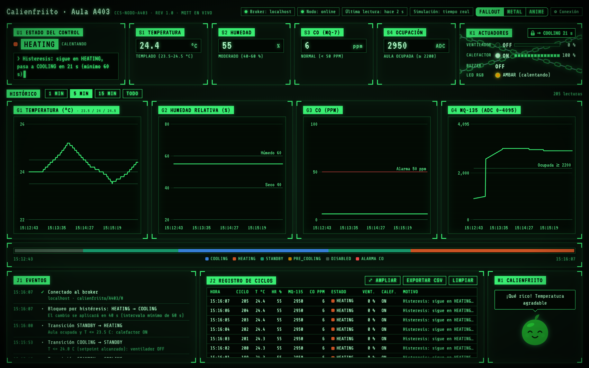
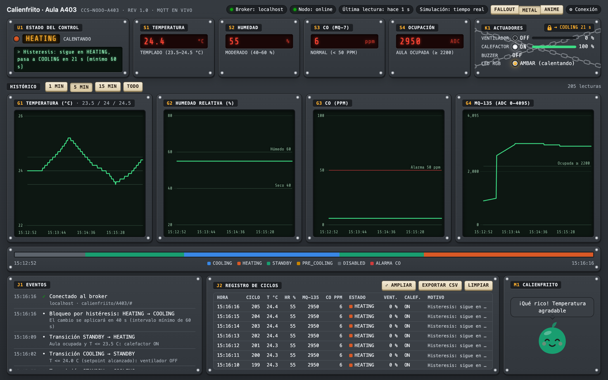
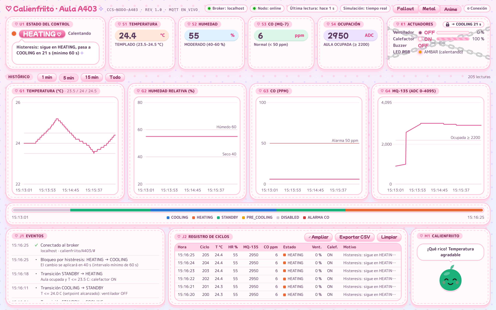

# Climate Cognitive System (CCS) · Aula A403

Proyecto **CS5055 Internet of Things — UTEC 2026-2**. Integra las dos mitades del sistema:

- **El nodo IoT:** un ESP32 con DHT22, MQ-135 y MQ-7, simulado en Wokwi. Decide en el propio nodo si
  enfriar, calentar o esperar, con una alarma de CO local, y mueve ventilador, calefactor, buzzer y LED RGB.
- **La plataforma cognitiva:** backend FastAPI con PostgreSQL y MongoDB, modelo de ML, dashboard React,
  reservas, reportes de ahorro y chat.

Los une **MQTT**: el nodo publica su telemetría y el backend la recibe, la guarda y corre su modelo de IA
**en paralelo** (modo sombra), para comparar sus decisiones con las del nodo.

```
 ESP32 en Wokwi ──MQTT 1883──► Mosquitto ──► backend FastAPI ──► MongoDB / PostgreSQL ──► dashboard React
 (decide y actúa)                  │          (ingesta MQTT +                               localhost:3000
                                   │           IA en sombra)
                                   └──WebSocket 9001──► monitor del nodo (localhost:3000/monitor/)
```

| Monitor del nodo: Fallout | Metal | Anime |
|---|---|---|
|  |  |  |

---

## Qué hay en el repositorio

| Carpeta | Qué es |
|---|---|
| [`hardware/firmware/`](hardware/firmware/) | **Firmware del ESP32** y circuito de Wokwi ([guía del nodo](hardware/firmware/README.md)) |
| [`hardware/sistema.py`](hardware/sistema.py) | Puerta de enlace anterior (Arduino UNO + cámara); queda para el conteo con cámara |
| [`infra/mqtt/`](infra/mqtt/) | Configuración de **Mosquitto** |
| [`backend/`](backend/) | API FastAPI. La ingesta MQTT está en [`app/services/mqtt_ingest.py`](backend/app/services/mqtt_ingest.py) |
| [`frontend/`](frontend/) | Dashboard React. El monitor del nodo está en [`public/monitor/`](frontend/public/monitor/index.html) |
| [`infra/database/`](infra/database/) | Scripts de inicio de PostgreSQL y MongoDB |
| [`ml/seed_data/`](ml/seed_data/) | Datos semilla: aulas (incluida A403), sensores, horarios y lecturas históricas |
| [`ml/pipeline/`](ml/pipeline/) | Entrenamiento del modelo de carga térmica |
| [`tools/broker-local/`](tools/broker-local/) | Broker MQTT liviano para probar solo el nodo, **sin Docker** |
| [`docs/`](docs/) | Perfil del proyecto, estados y escenarios, presupuesto, diagrama y [documentación de la plataforma](docs/PLATAFORMA.md) |
| [`informe/`](informe/) | Informe en LaTeX (plantilla ACM) |

## Requisitos

- **[Docker Desktop](https://www.docker.com/products/docker-desktop/)** (Docker ≥ 24 y Compose ≥ 2), **abierto**.
- **VS Code** con las extensiones **Wokwi Simulator** (licencia gratuita *Community*) y **PlatformIO IDE**.
- **Python 3.12** para cargar los datos semilla.
- **Node.js 18+**, solo si vas a usar el broker liviano sin Docker.

## Paso a paso

### 1. Configurar y levantar la plataforma

```bash
cp .env.example .env
docker compose up --build -d
docker compose ps          # mosquitto, postgres, mongo, backend y frontend en "running"
```

| Servicio | Dirección |
|---|---|
| Dashboard React | http://localhost:3000 (usuario `admin`, contraseña `admin` en desarrollo) |
| Monitor del nodo | http://localhost:3000/monitor/ |
| API y documentación | http://localhost:8000/docs |
| MQTT | `localhost:1883` (TCP) y `localhost:9001` (WebSocket) |

### 2. Cargar los datos semilla (la primera vez)

Crea el aula **A403** y su sensor **`s-A403`**, que es el que usa el nodo. Sin este paso las lecturas del nodo
igual se guardan, pero el dashboard React no muestra el aula.

```bash
python3.12 -m venv .venv && source .venv/bin/activate
pip install -r backend/requirements.txt
python ml/seed_data/generate_dataset.py
```

Más detalles en [`ml/seed_data/DATASET_GUIDE.md`](ml/seed_data/DATASET_GUIDE.md).

### 3. Compilar y simular el nodo

1. En VS Code abre el workspace **`ccs.code-workspace`** (File → Open Workspace from File).
   Incluye `hardware/firmware` como carpeta propia, que es lo que necesitan PlatformIO y Wokwi.
2. Compila el firmware con el **✓ (Build)** de PlatformIO (o `pio run` dentro de `hardware/firmware`).
3. Abre `hardware/firmware/diagram.json` y pulsa **▶** (o `Cmd/Ctrl + Shift + P` → *Wokwi: Start Simulator*).

En la Wokwi Terminal deberías ver:

```
[     2.8 s] RED  MQTT conectado a host.wokwi.internal:1883 | cliente calienfriito-A403-sim-...
[     2.8 s] RED  Publica en ccs/A403/telemetry | suscrito a ccs/A403/command
```

### 4. Ver el nodo en vivo

> ⚠️ **Wokwi pausa la simulación cuando VS Code no está a la vista.** Si el navegador tapa VS Code, el nodo
> se congela, deja de publicar y aparece *offline*.

Abre el monitor **dentro de VS Code**, al lado del simulador:
`Cmd/Ctrl + Shift + P` → **Simple Browser: Show** → `http://localhost:3000/monitor/`, y arrastra esa pestaña a la derecha.

### 5. Comprobar que el backend recibe la telemetría

```bash
docker compose logs -f backend | grep INGEST
# [INGEST] sensor_id=s-A403 is_simulated=True co_ppm=4.0 ts=...

curl "http://localhost:8000/api/v1/sensors/?sensor_id=s-A403&limit=1"
```

Cada lectura guardada trae **las dos decisiones**:

- `node_state`: lo que decidió y ejecutó el **nodo** (`accion`, `motivo`, actuadores, bloqueo por histéresis).
- `cognitive_action`: lo que decidió el **backend** con el modelo de IA o su heurística, en modo sombra.

Esa comparación es la base de la figura de resultados del proyecto ([`docs/PROYECTO_REDEFINIDO_CS5055.md`](docs/PROYECTO_REDEFINIDO_CS5055.md), §1).

## Probar solo el nodo, sin Docker

Para trabajar en el firmware o en el monitor sin levantar toda la plataforma:

```bash
cd tools/broker-local
npm install      # la primera vez
npm start        # MQTT 1883 + WebSocket 9001 + monitor en http://localhost:9001
```

No lo levantes a la vez que Docker: usan los mismos puertos.

## Cómo se conectan las piezas

| Pieza | Detalle |
|---|---|
| Tópicos | `ccs/A403/telemetry`, `status` (Last Will), `config` (umbrales) y `command` (reservado) |
| Ingesta | El backend se suscribe a `ccs/+/telemetry`, traduce cada mensaje a `SensorReading` (`sensor_id = s-<aula>`) y lo procesa igual que `POST /api/v1/sensors/` |
| CO₂ | El nodo envía `co2_ppm` (conversión simulada del MQ-135, 400–2000 ppm); el backend estima la ocupación como (CO₂ − 420) / 25 |
| Lecturas simuladas | El nodo marca `is_simulated: true`; el backend las separa de las del hardware real |
| Sin DHT | Si el DHT22 no lee, el nodo sigue controlando, pero esa lectura no se guarda (el backend exige temperatura y humedad) |
| Variables | `MQTT_ENABLED`, `MQTT_TOPIC` en `.env` (ver `.env.example`) |

## Solución de problemas

| Síntoma | Causa | Solución |
|---|---|---|
| Wokwi: `Error de conexion MQTT (rc=-2)` | Mosquitto no está corriendo | `docker compose up -d` (o el broker liviano) |
| Monitor: **Nodo: offline (LWT)** | Wokwi se pausó porque VS Code no estaba visible | Monitor en Simple Browser al lado del simulador |
| El aula A403 no aparece en el dashboard React | Faltan los datos semilla | Paso 2 |
| Backend: `MQTT broker mosquitto:1883 unavailable` | Mosquitto no arrancó | `docker compose logs mosquitto` |
| `docker compose` no responde | Docker Desktop cerrado | Abre Docker Desktop |

---

**Equipo:** Brayan Eduardo Gomero Castillo · Kiara Alexandra Balcázar Santa Cruz · Rodrigo Dion Carlos Acosta
