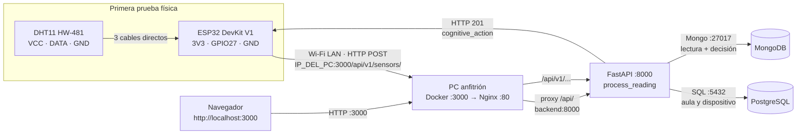
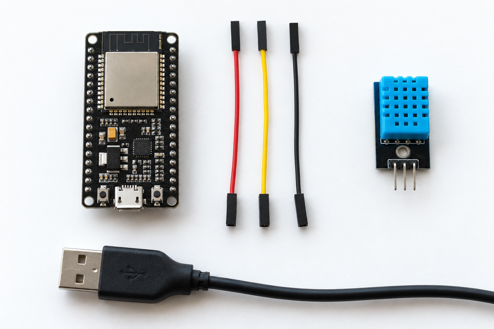
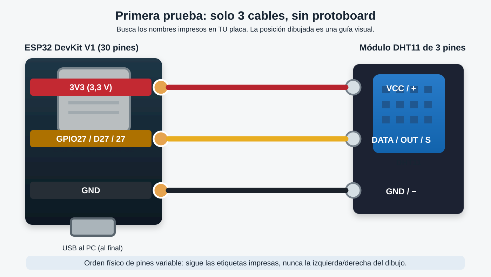
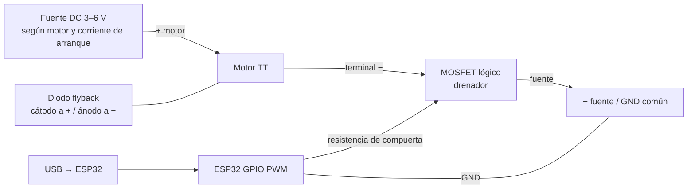

# Kit de sensores para probar CCS en local

Esta guía propone una **primera prueba deliberadamente simple**: **ESP32 DevKit V1 de 30 pines + DHT11 HW-481 de 3 pines + tres cables Dupont + USB**. Con ella comprobarás lectura física de temperatura y humedad, envío al backend, decisión cognitiva y visualización en la web. El pulsador y la protoboard quedan para una segunda etapa: no hacen falta para lograr la primera lectura. Usaremos la **ESP32 DevKit V1 (Micro-USB)** que ya tienes; la placa USB-C queda de repuesto. En clones de DevKit V1 cambia la posición física de los pines, así que identifica los **nombres impresos** `3V3`, `GND` y `27`/`D27`/`GPIO27` en tu propia placa antes de enchufar un cable.

### Orden de trabajo

1. Reúne los cables y verifica las etiquetas de cada pieza (§1 y §3).
2. Inicia Docker y comprueba API, frontend y bases de datos (§4).
3. Crea el aula y el dispositivo; prueba el POST desde el PC antes de usar hardware (§4).
4. Con el USB desconectado, conecta solo ESP32 + DHT11 con tres cables (§3, pasos 1–9).
5. Carga el sketch, abre el monitor serie y comprueba el recorrido completo en la web (§5 y §6).

**Material auxiliar imprescindible que no aparece en tu inventario:** un cable **Micro-USB de datos** y **tres cables Dupont hembra-hembra**, si ambas placas exponen pines macho. Sin ellos no se puede cablear ni programar esta primera prueba. También necesitas un PC con Docker Desktop, Arduino IDE y Wi-Fi de 2,4 GHz accesible para el ESP32. Si el HW-481 carece de pull-up de datos, añade una resistencia cercana a 10 kΩ entre DATA y 3V3; algunos módulos de 3 pines ya la incluyen. Un multímetro ayuda a verificar la alimentación, pero el primer montaje no requiere identificar pistas de protoboard.

## 1. Qué se puede probar con lo disponible

| Pieza | Uso en esta prueba | Motivo |
|---|---|---|
| ESP32 DevKit V1 Micro-USB, 30 pines | **Usar ahora** | Lee el DHT11 y envía HTTP por Wi-Fi. |
| ESP32-WROOM-32 de 30 pines USB-C | Repuesto | También serviría, pero esta guía fija la DevKit V1 para no mezclar conectores y configuraciones. |
| DHT11 HW-481 de 3 pines | Sí | Aporta temperatura y humedad, los dos campos obligatorios de `SensorReading`. |
| Pulsador normalmente abierto | No en la primera prueba | El firmware envía periódicamente sin intervención. Se puede añadir luego de confirmar la lectura del DHT11. |
| Protoboard de 400 puntos | No en la primera prueba | Tres cables directos reducen los lugares donde puede fallar una conexión. Se usará al añadir componentes. |
| ESP32-CAM y ESP32-CAM-MB | No en la primera prueba | La cámara **no sustituye** al DHT11 ni se integra automáticamente al conteo de ocupación de `hardware/sistema.py`, que usa la cámara del portátil con MediaPipe. El adaptador MB solo programa/alimenta la ESP32-CAM. |
| Módulo de 2 relés de 5 V | Reservar | Requiere alimentación de 5 V y verificar si sus entradas reconocen 3,3 V. El backend no lo controla directamente por HTTP. |
| Motorreductor TT de 3–6 V y hélice | Reservar | Necesita fuente adecuada, conmutación y diodo de protección. Una hélice descubierta no es apropiada para un montaje de mesa. |
| LED RGB de 4 pines | Reservar | Hay que identificar ánodo/cátodo común y usar resistencias limitadoras por color; no figuran entre las piezas disponibles. |
| Buzzer de 2 pines | Reservar | Hay que confirmar tensión, corriente y si es activo o pasivo antes de elegir conexión/driver. |
| NTC 8D-20, 8 Ω, 20 mm | No usar como sensor ambiente | Este formato corresponde a un limitador de corriente de arranque; no ofrece por sí solo una medición de temperatura calibrada. No conectarlo directamente a un GPIO. |

**Alcance real:** no tendrás lecturas de CO (`co_ppm`), CO₂ (`co2_ppm`), ocupación por cámara, corriente ni potencia medida. Deja esos campos ausentes o `null`; nunca inventes `0 ppm`, `0 W` ni `alarm_active=true`. El backend puede presentar una **estimación nominal** de consumo basada en la configuración de otro nodo: no es una medida de este kit. Tampoco se validan aquí la alarma local por CO, el ventilador PWM de 12 V ni el objetivo de latencia de la especificación completa.

## 2. Arquitectura y puertos de red

El `docker-compose.yml` actual publica el backend solo en `127.0.0.1:8000`, inaccesible desde el ESP32 por Wi-Fi. El frontend Nginx sí publica `3000:80` y reenvía `/api/` al backend. Por eso el firmware usa `http://IP_DEL_PC:3000/api/v1/sensors/`. **`localhost` en el ESP32 sería el propio ESP32**.



| Origen | Destino | Puerto / ruta | Función |
|---|---|---|---|
| USB del PC | USB de la DevKit | Puerto USB/COM, sin TCP | Alimentación, carga y monitor serie. |
| ESP32 por Wi-Fi | IP privada del PC | TCP **3000**, `/api/v1/sensors/` | Envío JSON; el firewall debe permitir acceso desde la misma LAN. |
| Navegador del PC | PC | TCP **3000** | Interfaz React. |
| Nginx en contenedor `frontend` | `backend` en red Compose | TCP **8000** | Proxy de `/api/` y `/health`. |
| Backend | `postgres` / `mongo` | TCP **5432** / **27017** | Contexto del aula / persistencia. |

El puente MQTT existe en `backend/app/services/mqtt_bridge.py`, pero está desactivado por defecto y **el Compose actual no incluye un broker**. Si se añadiera uno en una fase posterior: ESP32 → broker TCP 1883 (`ccs/<aula>/telemetry` y `status`); backend → broker 1883; broker → ESP32 (`ccs/<aula>/cmd`). No uses esos tópicos para la primera prueba HTTP. En HTTP recibes la decisión en la respuesta, pero el firmware de ejemplo solo la registra en el monitor serie; **no acciona hardware**.

## 3. Armado físico de la primera prueba: exactamente tres cables

**Imagen para reconocer las piezas:**



La foto generada muestra el **aspecto y la disposición** de las piezas, todavía desconectadas. Puede no coincidir con la serigrafía o el conector de tu placa. Para decidir en qué pin enchufar cada cable, usa **el esquema siguiente y las letras impresas en tus componentes**.

**Esquema exacto de conexiones (amplíalo para leer las etiquetas):**



| Cable | En la ESP32 DevKit V1 | En el DHT11 HW-481 | Qué hace |
|---|---|---|---|
| **Rojo** | Pin impreso `3V3` | Pin impreso `VCC` o `+` | Lleva 3,3 V al sensor. |
| **Amarillo** | Pin impreso `27`, `D27` o `GPIO27` | Pin impreso `S`, `OUT` o `DATA` | Lleva los datos del sensor. |
| **Negro** | Pin impreso `GND` | Pin impreso `GND` o `−` | Cierra el circuito, tierra. |

**No uses los números de posición de las patas ni supongas un orden izquierda→derecha.** La etiqueta `ESP-WROOM-32` identifica el módulo metálico central, pero el cable se enchufa en el **pin exterior de la placa de desarrollo** que dice `27`/`D27`/`GPIO27`. Busca las letras de los tres contactos del DHT11 en la cara frontal o trasera del pequeño PCB. Si no hay letras legibles, detén el cableado antes de energizar: el orden no puede determinarse con seguridad a partir del color del plástico azul. En particular, `5V`, `VIN` y `3V3` son pines distintos; para este sensor usa solo `3V3`. Las guías del DHT11 admiten alimentación a 3,3 V y describen el pull-up de datos [1]; los GPIO del ESP32 son de lógica 3,3 V [2].

### Hazlo en este orden

1. **Deja el USB desconectado.** Pon la DevKit V1 sobre la mesa con el conector Micro-USB mirando hacia ti y el módulo metálico con la inscripción ESP-WROOM-32 arriba. Pon el DHT11 a su derecha con sus tres patitas metálicas apuntando hacia abajo. La protoboard, el pulsador y todos los demás componentes se quedan aparte.
2. **Encuentra los pines.** Lee la serigrafía junto a los pines exteriores de la DevKit y localiza exactamente `3V3`, `GND` y `27`/`D27`. Lee `VCC`/`+`, `S`/`OUT`/`DATA` y `GND`/`−` en el DHT11. Una linterna o una foto ampliada del teléfono ayuda si la letra es pequeña. Anota las tres parejas de la tabla antes de enchufar nada.
3. **Coloca el cable negro.** Enchufa una hembra en `GND` de la DevKit y la otra en `GND`/`−` del DHT11. Si tu ESP32 tiene más de un `GND`, sirve cualquiera marcado así.
4. **Coloca el cable rojo.** Enchufa una hembra en `3V3` de la DevKit y la otra en `VCC`/`+` del DHT11. Comprueba una segunda vez que el extremo del ESP32 dice **3V3**, nunca `5V` ni `VIN`.
5. **Coloca el cable amarillo.** Enchufa una hembra en `27`/`D27`/`GPIO27` de la DevKit y la otra en `S`/`OUT`/`DATA` del DHT11. No uses `26` ni otro pin parecido: el sketch de §5 lee el GPIO27.
6. **Revisión sin corriente.** Sigue cada cable con el dedo de punta a punta y lee otra vez la tabla. Los tres conectores no deben tocar patitas vecinas ni quedar flojos. El DHT11 puede quedar sostenido por los cables o apoyado sobre una superficie aislante; no apoyes las patitas desnudas sobre metal.
7. **Ahora sí conecta el Micro-USB al PC.** El USB alimenta la ESP32 y esta entrega 3,3 V al DHT11. No conectes otra fuente al sensor ni al pin `VIN`. Si notas olor, humo o calentamiento anormal, desconecta inmediatamente y repite la revisión.
8. **Carga el sketch de §5 y abre el monitor serie** a 115200 baudios. Debes ver una temperatura y humedad plausibles, luego el resultado HTTP. Si aparece `lectura fallida`, desconecta el USB y revisa primero los cables rojo, negro y amarillo; algunos módulos requieren una resistencia de ~10 kΩ entre DATA y 3V3 que quizá no tengas aún.
9. **Confirma en la web (§6).** Cuando veas `HTTP 201`, abre `http://localhost:3000` y busca el aula `LAB_LOCAL` y el sensor `esp32-dht-local`. Ya habrás probado el recorrido físico completo.

## 4. Preparar el proyecto local

Desde la raíz del repositorio, en PowerShell:

```powershell
if (-not (Test-Path .env)) { Copy-Item .env.example .env }
(Get-Content .env) -replace '^ADMIN_PASSWORD=$', 'ADMIN_PASSWORD=admin' | Set-Content .env
docker compose version
docker compose up --build -d
docker compose ps
Invoke-RestMethod http://localhost:8000/health
```

Abre Docker Desktop antes de ejecutar los comandos. `docker compose ps` debe mostrar `postgres`, `mongo`, `backend` y `frontend` en ejecución; `/health` debe devolver `status: ok`. Si falla, ejecuta `docker compose logs --tail 80 backend` y `docker compose logs --tail 80 frontend` para encontrar el error. Evita `docker compose down -v` para esta prueba: borra los volúmenes de las bases de datos. La interfaz está en `http://localhost:3000` y la documentación API en `http://localhost:8000/docs`. El archivo `.env.example` deja `ADMIN_PASSWORD` vacío; el segundo comando le asigna `admin` **solo para un entorno local nuevo**. Si ya existe la base de datos o configuraste otra contraseña, usa la vigente: el arranque no reemplaza una contraseña válida. Si la máquina será compartida, elige una contraseña distinta y cambia también el comando de login siguiente.

Necesitas **un aula y un dispositivo activos**. Si cargaste `seed_data/generate_dataset.py` y ya existe A403 con `s-A403`, usa esos identificadores. Si quieres aislar las pruebas, crea `LAB_LOCAL` y `esp32-dht-local` desde el administrador web o con la API autenticada. `POST /api/v1/admin/sensors` crea el sensor **inactivo**, por lo que para esta guía conviene `POST /api/v1/admin/devices`, que permite `is_active=true` y `control_enabled=true`. No reutilices el ID de un sensor físico en producción.

```powershell
$base = 'http://localhost:8000'
$login = Invoke-RestMethod -Method Post -Uri "$base/api/v1/auth/login" -ContentType 'application/x-www-form-urlencoded' -Body 'username=admin&password=admin'
$auth = @{ Authorization = "Bearer $($login.access_token)" }
$room = @{ id='LAB_LOCAL'; name='Laboratorio local'; max_capacity=5; target_temp=24 } | ConvertTo-Json
Invoke-RestMethod -Method Post -Uri "$base/api/v1/admin/rooms" -Headers $auth -ContentType 'application/json' -Body $room
$device = @{ sensor_id='esp32-dht-local'; room_id='LAB_LOCAL'; is_active=$true; control_enabled=$true } | ConvertTo-Json
Invoke-RestMethod -Method Post -Uri "$base/api/v1/admin/devices" -Headers $auth -ContentType 'application/json' -Body $device
```

Si el aula ya existe, omite solo el `POST /rooms`; `POST /devices` actualiza un dispositivo existente. Para decidir el ID, comprueba `GET /api/v1/admin/devices` con el mismo token. Si `.env` contiene `WATSON_EXTENSION_KEY`, el firmware debe enviar ese valor en la cabecera `X-API-Key`; si está vacío, la ruta acepta POST sin esa cabecera. No copies una clave de despliegue público al sketch de prueba.

**Comprueba primero el software sin ESP32.** Desde el mismo PowerShell, envía una lectura de prueba diferenciada como simulada y verifica que la API responde `201` con `cognitive_action` y `room_context`. Así sabrás que el aula, el dispositivo, las bases y el motor cognitivo están listos antes de depurar cables:

```powershell
$apiHeaders = @{ 'Content-Type'='application/json' }
# Si configuraste WATSON_EXTENSION_KEY: $apiHeaders['X-API-Key'] = 'TU_CLAVE_LOCAL'
$testReading = @{ sensor_id='esp32-dht-local'; temperature=24.5; humidity=55; is_simulated=$true; data_origin='simulator' } | ConvertTo-Json
Invoke-RestMethod -Method Post -Uri "$base/api/v1/sensors/" -Headers $apiHeaders -Body $testReading
Invoke-RestMethod -Uri "$base/api/v1/sensors/?sensor_id=esp32-dht-local&limit=3" -Headers $apiHeaders
```

Una respuesta `201` que incluya `skipped=true` indica que el dispositivo está inactivo; si falta `room_context`, revisa su registro en PostgreSQL. Si `POST /rooms` devolvió `409`, el aula ya existía: consulta su ID y continúa. La primera lectura simulada puede aparecer en el historial; distingue luego las lecturas del ESP32 por `data_origin=node` e `is_simulated=false`.

En el PC, averigua la IPv4 de la interfaz conectada a la **misma red Wi-Fi** del ESP32:

```powershell
ipconfig
Test-NetConnection -ComputerName localhost -Port 3000
```

Pon esa dirección en `PC_IP` del sketch, por ejemplo `192.168.1.25`. Desde **otro equipo de la misma Wi-Fi**, comprueba `http://IP_DEL_PC:3000/health`. Si falla, verifica que no sea una red de invitados con aislamiento entre clientes y autoriza **solo TCP 3000 en la red privada local** en el firewall de Windows; no necesitas publicar TCP 8000, 5432 ni 27017. La aplicación por HTTP en LAN es apropiada para esta prueba local; usa credenciales de desarrollo.

## 5. Firmware de prueba (Arduino IDE)

### Variante USB/Serial para `MI-CUARTO` y el sensor `Prueba tipo 1`

Si quieres que **Python envíe las mediciones reales del DHT11**, carga en la ESP32
[`hardware/prueba1_dht11_serial/prueba1_dht11_serial.ino`](../hardware/prueba1_dht11_serial/prueba1_dht11_serial.ino).
Este sketch lee el DHT11 en GPIO27 y entrega un JSON por USB/Serial cada 10 s;
no necesita Wi-Fi. Instala en Arduino IDE la biblioteca **DHT sensor library** de
Adafruit y su dependencia **Adafruit Unified Sensor**. Después de subir el sketch,
cierra el Monitor serie y ejecuta desde la raíz del proyecto:

```powershell
python -m pip install pyserial
python hardware/prueba1_mi_cuarto.py --port COM6
```

Sustituye `COM6` por el puerto que muestra Arduino IDE. Si solo hay un puerto
serie, puedes omitir `--port`. El script publica en la API local con el ID exacto
`Prueba tipo 1`, comprueba que la API lo asocia a `MI-CUARTO` y marca las lecturas
como datos del nodo (`is_simulated=false`, `data_origin=node`). Pulsa `Ctrl+C`
para detenerlo. La variante Wi-Fi que sigue es una alternativa independiente:
publica desde la ESP32 directamente y no usa este script Python.

En Arduino IDE, abre **Herramientas → Placa → ESP32 Arduino → DOIT ESP32 DEVKIT V1** (si esa opción no aparece, elige `ESP32 Dev Module`) y **Herramientas → Puerto → COM...** correspondiente al USB recién conectado. Instala previamente el soporte **esp32 de Espressif** desde el Gestor de placas y la biblioteca **DHT sensor library de Adafruit** desde el Gestor de bibliotecas (acepta la dependencia **Adafruit Unified Sensor**). Copia el código en un sketch nuevo, cambia `WIFI_SSID`, `WIFI_PASS`, `PC_IP` y, si procede, `API_KEY`; pulsa **Verificar**, luego **Subir**. Después abre **Herramientas → Monitor serie** y selecciona **115200 baudios**. Si la carga queda esperando, mantén pulsado `BOOT` mientras empieza la transferencia y suéltalo cuando avance. El DHT11 se lee cada 10 s sin pulsador.

```cpp
#include <WiFi.h>
#include <HTTPClient.h>
#include <DHT.h>

constexpr int DHT_PIN = 27;
constexpr int DHT_TYPE = DHT11;
constexpr unsigned long PERIOD_MS = 10000;

const char* WIFI_SSID = "NOMBRE_WIFI";
const char* WIFI_PASS = "CLAVE_WIFI";
const char* PC_IP = "192.168.1.25";  // IPv4 privada del PC, sin http://
const char* SENSOR_ID = "esp32-dht-local";
const char* API_KEY = "";            // WATSON_EXTENSION_KEY si está configurada

DHT dht(DHT_PIN, DHT_TYPE);
unsigned long lastSend = 0;

void sendReading() {
  float humidity = dht.readHumidity();
  float temperature = dht.readTemperature();
  if (isnan(humidity) || isnan(temperature)) {
    Serial.println("DHT11: lectura fallida; revisar VCC/DATA/GND y pull-up");
    return;
  }
  if (WiFi.status() != WL_CONNECTED) {
    Serial.println("Wi-Fi desconectado; reintentando");
    WiFi.reconnect();
    return;
  }

  String url = "http://" + String(PC_IP) + ":3000/api/v1/sensors/";
  String body = String("{\"sensor_id\":\"") + SENSOR_ID +
                "\",\"temperature\":" + String(temperature, 1) +
                ",\"humidity\":" + String(humidity, 1) +
                ",\"is_simulated\":false,\"data_origin\":\"node\"}";

  HTTPClient http;
  http.setTimeout(5000);
  if (!http.begin(url)) {
    Serial.println("No se pudo preparar HTTP");
    return;
  }
  http.addHeader("Content-Type", "application/json");
  if (strlen(API_KEY) > 0) http.addHeader("X-API-Key", API_KEY);
  int status = http.POST(body);
  Serial.printf("DHT11 %.1f C, %.1f %% | HTTP %d\n", temperature, humidity, status);
  Serial.println(http.getString());  // incluye cognitive_action cuando hay 201
  http.end();
}

void setup() {
  Serial.begin(115200);
  dht.begin();
  WiFi.begin(WIFI_SSID, WIFI_PASS);
  Serial.print("Conectando Wi-Fi");
  while (WiFi.status() != WL_CONNECTED) {
    delay(500);
    Serial.print('.');
  }
  Serial.printf("\nESP32 IP: %s\n", WiFi.localIP().toString().c_str());
  sendReading();
  lastSend = millis();
}

void loop() {
  if (millis() - lastSend >= PERIOD_MS) {
    sendReading();
    lastSend = millis();
  }
  delay(100);
}
```

Este sketch es una herramienta de prueba, no el firmware MQTT de `docs/hardware-spec.md`. El DHT11 tiene resolución y precisión modestas; busca cambios plausibles al acercar la mano o variar el ambiente, no lo uses como termómetro de referencia. El navegador mostrará datos de un nodo real (`data_origin=node`, `is_simulated=false`), pero eso **no certifica** CO, consumo medido ni actuación real.

## 6. Comprobación de extremo a extremo

1. Abre el monitor serie a **115200 baudios**. Debes ver la IP del ESP32 y, cada 10 s, temperatura, humedad y `HTTP 201`.
2. Espera unos 10 s y confirma un segundo envío. Una lectura DHT fallida produce un mensaje y no envía datos falsos.
3. Comprueba en la respuesta JSON `cognitive_action` y el aula registrada. Abre `http://localhost:3000`, entra con el admin local y mira el aula `LAB_LOCAL` / dispositivo `esp32-dht-local`.
4. En el PC, `Invoke-RestMethod http://localhost:8000/health` debe indicar `status=ok`; `mqtt=disabled` es **esperado** en esta ruta HTTP.
5. Si ves `HTTP 422`, revisa nombres y tipos de `sensor_id`, `temperature`, `humidity`. `HTTP 403` suele indicar API key distinta. `HTTP -1` o timeout indica IP, Wi-Fi o firewall. Si llega `201` pero no aparece contexto del aula, comprueba que el dispositivo exista, esté activo y ligado al aula. Un dispositivo inactivo descarta la lectura; uno con control deshabilitado la guarda con acción `DISABLED`.

## 7. Extensión posterior: actuadores y sensores faltantes

### Prueba 2 con el pulsador de cuatro patas (sin motor)

Usa el sketch [`hardware/prueba2_dht11_boton_serial/prueba2_dht11_boton_serial.ino`](../hardware/prueba2_dht11_boton_serial/prueba2_dht11_boton_serial.ino)
con [`hardware/prueba2_mi_cuarto.py`](../hardware/prueba2_mi_cuarto.py).
Con el USB desconectado, deja el DHT11 en `D27`, `3V3` y `GND`.
Localiza `D26` en la misma hilera de la ESP32, entre `D25` y `D27`.
Coloca el pulsador atravesando la ranura central de la protoboard; por ejemplo,
con las cuatro patas en `E20`, `E22`, `F20` y `F22` si esas posiciones están libres
y el pulsador encaja sin forzarlo. Conecta **dos esquinas opuestas**: `E20` a
`D26` y `F22` a un `GND` de la ESP32. No conectes el pulsador a `3V3` ni a `5V`.
El código configura `D26` con `INPUT_PULLUP`: sin pulsar lee HIGH y al pulsar
lee LOW. Los dos cables van a mitades opuestas de la ranura. Si tu pulsador no
coincide con este patrón, identifica con un multímetro las dos parejas que ya
tienen continuidad sin pulsar y usa una pata de cada pareja.

Carga el sketch en Arduino IDE con `DOIT ESP32 DEVKIT V1`, puerto de la ESP32
y velocidad de carga `115200`. Cierra el Monitor serie y ejecuta
`python hardware/prueba2_mi_cuarto.py --port COM12` (ajusta el COM si cambió).
El terminal indicará `periodica` cada 10 s y `boton` al pulsar. No se envía una
lectura si el DHT11 acaba de medirse hace menos de 2 s; espera y pulsa otra vez.

### Prueba 3: decisión de la API de vuelta a la ESP32 (sin actuador)

Conserva el cableado de la prueba 2. Carga
[`hardware/prueba3_control_virtual/prueba3_control_virtual.ino`](../hardware/prueba3_control_virtual/prueba3_control_virtual.ino)
y, tras cerrar el Monitor serie, ejecuta
`python hardware/prueba3_mi_cuarto.py --port COM12` (ajusta el puerto si cambió).
El script envía la lectura real al mismo sensor `Prueba tipo 1` de `MI-CUARTO`,
toma **la acción activa** y el `fan_pwm` de la respuesta, y devuelve una línea
`CMD,secuencia,acción,pwm` por USB/Serial. La ESP32 valida la secuencia y responde
`ACK,secuencia,acción,pwm`; el terminal Python imprime la confirmación. Si no
llega `ACK` en 3 s, lo indica. Esta prueba verifica comunicación y decisión de
ida y vuelta; `fan_pwm` es una **orden solicitada**, no potencia ni velocidad
medidas. El sketch no acciona ningún GPIO de salida, relé ni motor.

La especificación del proyecto prevé DHT11 + MQ-135 + MQ-7 + INA219, ventilador **12 V con PWM**, LED RGB y buzzer de alarma. Tu motor TT de **3–6 V** puede ilustrar encendido/apagado, pero no equivale a ese ventilador ni permite validar su PWM con un relé. El relé mecánico solo conmuta ON/OFF. Para el kit completo harían falta, como mínimo: sensores MQ-135/MQ-7 calibrables, INA219 si se quiere potencia medida, fuente DC dimensionada, regulador para la electrónica, MOSFET de nivel lógico para PWM, diodo de rueda libre, resistencias para RGB y protección mecánica de la hélice. El CO que informa una alarma requiere un sensor apropiado y calibración; no simules un valor de CO con el DHT11 ni con el NTC.

Esquema **condicional**, solo tras conseguir y verificar esos elementos:



No saques la corriente del motor de `3V3` ni de un GPIO del ESP32. La hélice debe quedar fijada y protegida. Si se optara por el módulo de relés de 5 V, alimenta `VCC`/`GND` con una fuente de 5 V adecuada, verifica **en su placa específica** la compatibilidad de `IN1` con lógica 3,3 V, la polaridad de activación y el aislamiento; después el contacto `COM`–`NO` podría cortar el positivo de una **fuente separada para el motor**, con diodo en paralelo al motor. No conectes cargas de red eléctrica en la protoboard. Un módulo rotulado JQC-3FF-S-Z solo identifica el tipo de relé; no define por sí solo el circuito de entrada de la placa.

Para sensores analógicos MQ en ESP32 con Wi-Fi, reserva pines **ADC1** y adapta cualquier salida que pueda superar 3,3 V; ADC2 no es apropiado mientras se usa Wi-Fi [2]. El buzzer y el RGB se conectan únicamente después de identificar tipo/polaridad y corriente y de añadir los elementos limitadores o drivers necesarios.

## Referencias técnicas

- [1] [Adafruit, conexión de sensores DHT](https://learn.adafruit.com/dht/connecting-to-a-dhtxx-sensor): alimentación de 3,3–5 V y pull-up de datos.
- [2] [Espressif, guía de diseño ESP32](https://docs.espressif.com/projects/esp-hardware-design-guidelines/en/latest/esp32/schematic-checklist.html): restricciones de GPIO y ADC1/ADC2 con Wi-Fi; [guía ESP32-DevKitC](https://docs.espressif.com/projects/esp-dev-kits/en/latest/esp32/esp32-devkitc/user_guide.html) para las etiquetas de pines y opciones de alimentación. Confirma el orden de pines en **tu** clon de 30 pines.
- [3] [Adafruit, motor DC con transistor y diodo](https://learn.adafruit.com/adafruit-arduino-lesson-13-dc-motors/transistors): corriente del motor y protección contra el pulso inductivo.
- [4] [Ficha de familia MF72, 8D-20](https://www.ntc-sensors.com/product/en/Product-NTC-8D20.html): componente de limitación de corriente de arranque.
- [5] Fuentes del proyecto: [`docker-compose.yml`](../docker-compose.yml), [`frontend/nginx.conf`](../frontend/nginx.conf), [`backend/app/models/sensor.py`](../backend/app/models/sensor.py), [`backend/app/routes/admin.py`](../backend/app/routes/admin.py), [`backend/app/services/mqtt_bridge.py`](../backend/app/services/mqtt_bridge.py), [`docs/hardware-spec.md`](hardware-spec.md).
